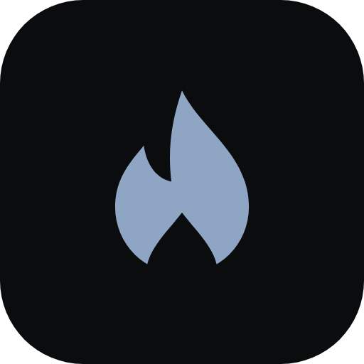

# Forgelight

A calm, minimal interface for [Stable Diffusion WebUI Forge](https://github.com/lllyasviel/stable-diffusion-webui-forge).

Forgelight runs inside Forge as an extension and is reachable at `http://127.0.0.1:7860/forgelight`. Every image is generated by Forge itself, exactly as in its classic page, which stays available alongside it.

> **Status:** ready for everyday use.

## Features

- A friendlier face for the [Forge](https://github.com/lllyasviel/stable-diffusion-webui-forge) engine
- A Library of all generated images, whether made in Forgelight or in Forge's classic page
- Settings remembered for each checkpoint
- Light, dark and pure black themes
- No telemetry, no tracking

And more.

## Requirements

- [Stable Diffusion WebUI Forge](https://github.com/lllyasviel/stable-diffusion-webui-forge), started with its API switched on. The API is how Forgelight asks Forge for images; Forgelight's desktop shortcut switches it on automatically (see below).

Switching the API on by hand

Open `<Forge installation>\webui\webui-user.bat` in a text editor, change `set COMMANDLINE_ARGS=` to `set COMMANDLINE_ARGS=--api`, save, and start Forge the usual way, for example with `run.bat` in the Forge installation folder.

## Installation & how to use

Install the latest released version, from the `release` branch or as a ZIP. The `main` branch holds source code only and does not run on its own.

1. **From Forge (easiest):** open **Extensions → Install from URL**, paste `https://github.com/symonxdd/forgelight`, type `release` under **Specific branch name** and click **Install**.
2. **With Git:** inside `<Forge installation>\webui\extensions`, run `git clone -b release https://github.com/symonxdd/forgelight`.
3. **As a ZIP:** on the [Releases page](https://github.com/symonxdd/forgelight/releases), download `forgelight-<version>.zip` (not the *Source code* files) and unzip it into `<Forge installation>\webui\extensions`.

Then restart Forge: close its black console window and start Forge again the usual way. Forgelight is now at `http://127.0.0.1:7860/forgelight`.

From there, the settings menu's **Desktop shortcut** creates a shortcut that starts Forge with its API switched on and opens Forgelight. Its **Guide** screen explains models, settings and prompting.

## Nice to know

- [Civitai](https://civitai.com) has thousands of free checkpoints, LoRAs and more. Checkpoints go in `<Forge installation>\webui\models\Stable-diffusion`, LoRAs in `<Forge installation>\webui\models\Lora`.
- Most checkpoints on Civitai list recommended settings. They make a good starting point.
- A LoRA only works with checkpoints from the model family it was made for: SD 1.5, SDXL or Flux. Pony and Illustrious both belong to the SDXL family, though a LoRA works best with checkpoints of its own kind.
- Settings copied from an image on Civitai can be pasted into the prompt box; click **Apply all**.
- The same seed with the same settings makes the same image again.
- The first image after switching checkpoints is slower while the model loads. An SSD helps.
- 6 GB of graphics memory is enough for SDXL-based models.

## Releases

Each version is listed on the [Releases page](https://github.com/symonxdd/forgelight/releases) and in [CHANGELOG.md](CHANGELOG.md). Version numbers follow [semantic versioning](https://semver.org): patch for fixes, minor for new features, major for changes that break existing habits. How a release is made: [docs/releasing.md](docs/releasing.md).

## License

Forgelight is free software under the [GNU Affero General Public License v3.0](LICENSE), the license Forge itself uses.

The name "Forgelight" and its logo are not covered by that license. Modified versions must use a different name and logo, as allowed by section 7(e) of the license.

## Development

See [docs/architecture.md](docs/architecture.md).
